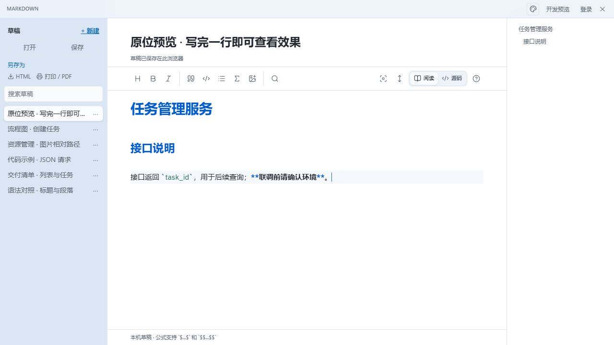
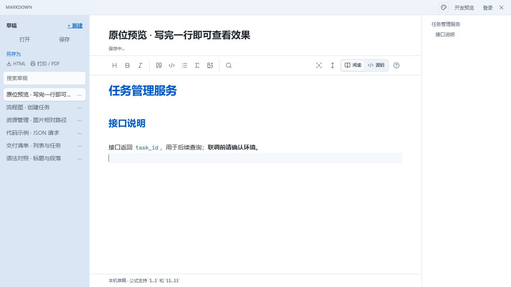
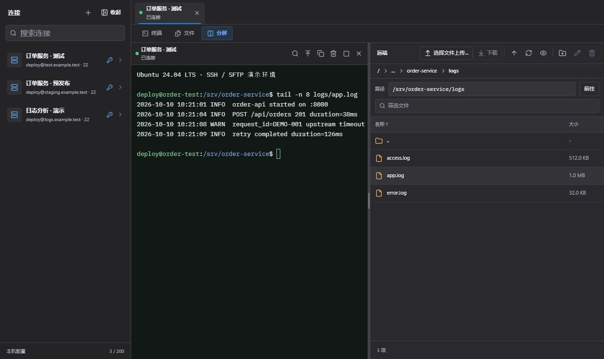
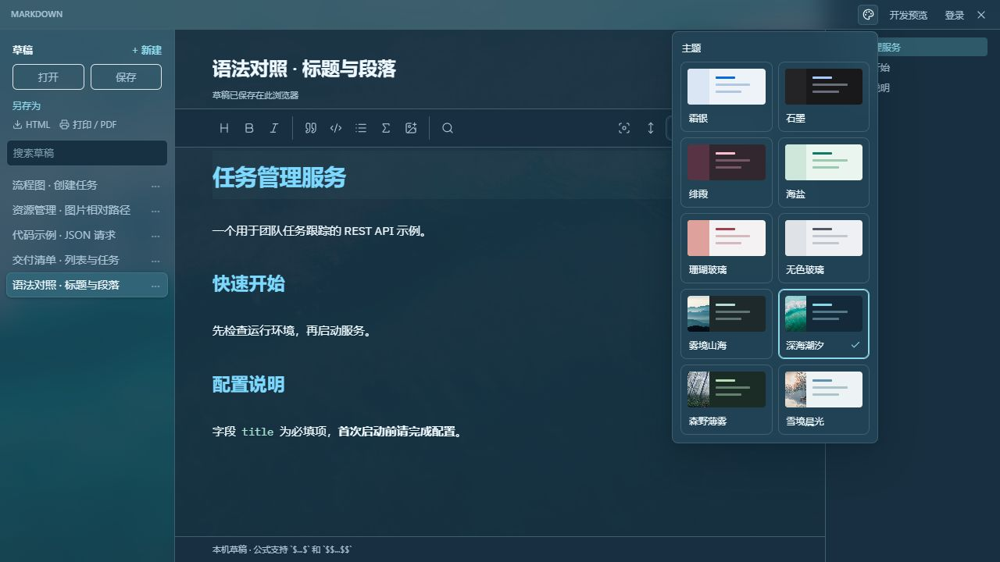

# Muse Nexus · 开发者桌面工具集

**Markdown 原位预览、SSH/SFTP 远程终端与文件管理、API 调试、数据库查询，以及日常数据处理工具。**

[官网与下载](https://lingban.xyz/) · [English](README.en.md) · [Markdown 使用指南](docs/markdown.md) · [SSH / SFTP 使用指南](docs/ssh-sftp.md) · [问题反馈](https://github.com/SSXiao/muse-nexus-showcase/issues)

Muse Nexus 将编写文档、调试接口、查询数据和管理远程文件等工作放在同一个桌面工具集中。各工具通过独立窗口使用，适合一边查看文档、一边联调接口，或者同时打开终端与文件视图排查服务问题。

本仓库是 Muse Nexus 的公开产品介绍、使用指南和反馈入口。应用安装包与平台支持情况请查看[官网](https://lingban.xyz/)。

## Markdown：写完一行，就在原位置看效果

保持“阅读”选中即可边写边看：**光标所在行显示可编辑的 Markdown 标记；按回车或把光标移到另一行，刚才的内容就在原位置呈现效果。返回原行，标记重新出现，继续修改。**

下面是同一文档的连续操作：

| 1. 编辑当前行 | 2. 移开光标，原位呈现 |
| --- | --- |
|  |  |

这套操作适合编写 README、API 接口说明、学习笔记和会议纪要。多行表格、代码块、Mermaid 图与独立公式按整个内容块编辑，光标离开块后检查效果。

- 使用标题大纲定位章节，利用行内代码标记字段、路径和命令。
- 使用代码块、参数表和任务清单组织技术文档。
- 通过 Mermaid 编写流程图，通过 KaTeX 呈现数学公式。
- 保存 `.md` 文件，导出 HTML，或通过系统打印生成 PDF。
- 使用专注模式、打字机模式及外观主题调整写作环境。

**从一个具体例子开始：** [Markdown 原位预览与项目文档编写](docs/markdown.md)。

## SSH / SFTP：终端与文件管理一起用

SSH / SFTP 是已经上线的功能。可以保存连接配置，在不同标签中打开会话，并在终端、文件和分屏视图之间切换。

终端 / 远端分屏示例：在终端中检查服务日志，同时在右侧浏览对应日志目录。

- 支持密码、Ed25519 / RSA 私钥及加密私钥认证。
- 首次连接确认主机指纹，已保存的主机密钥变化时阻止连接。
- 本地 / 远端双栏浏览，支持文件及文件夹上传、下载。
- 传输队列显示进度与状态，同名文件明确选择覆盖或跳过。
- SSH 客户端直接连接目标主机，账号服务不转发 SSH 流量。

**从一个具体例子开始：** [远程日志排查与文件传输](docs/ssh-sftp.md)。

## 其他工具

| 工具 | 主要能力 | 使用场景 |
| --- | --- | --- |
| API 调试 | 请求集合、环境变量、multipart、OpenAPI 导入 | 联调接口、检查请求与响应 |
| 数据库 | MySQL、SQLite、SQL 查询、数据浏览与结果导出 | 核对接口写入结果、检查本地数据 |
| 网络抓包 | 本地代理、HTTP / HTTPS 请求分析、发送到 API 工具 | 定位客户端请求问题并继续调试 |
| JSON / YAML | 格式化、校验、结构浏览、打开与保存文件 | 阅读接口数据、检查配置文件 |
| 开发者工具箱 | JWT 解码、Base64 / URL 编解码、图片 Base64、时间戳、Hash、UUID | 处理日常开发中的数据转换 |

工具适合配合使用：编写接口说明 → 在 API 工具发起请求 → 到数据库核对结果 → 通过 SSH 检查日志 → 将排查过程写回文档。

## 主题与语言

支持简体中文和 English 界面，以及浅色、深色和风景主题。主题切换调整工具窗口的写作与操作环境，文档正文、SQL 和请求内容保持原样。

## 开始使用

1. 打开 [lingban.xyz](https://lingban.xyz/)，下载适合自己系统的安装包。
2. 安装并启动 Muse Nexus，在工具中心选择需要的工具。
3. 写文档可先阅读 [Markdown 指南](docs/markdown.md)；管理服务器可先阅读 [SSH / SFTP 指南](docs/ssh-sftp.md)。

更完整的 Markdown 教程：[Markdown 文档编写指南：从基础语法到项目文档](https://zhuanlan.zhihu.com/p/2092204243587446116)。

## 反馈与文档

欢迎通过 [Issues](https://github.com/SSXiao/muse-nexus-showcase/issues) 提交使用问题、功能建议或文档修正。反馈时请注明应用版本、操作系统和可复现的操作步骤。

截图中的主机、日志及接口数据为演示内容；Markdown 截图来自浏览器开发预览，SSH 截图使用演示数据展示界面布局。实际 SSH 连接与桌面文件操作请在安装版中使用。

本仓库公开产品资料，不包含桌面应用和服务端源代码。Muse Nexus 产品名称、标识和应用的权利归各自权利人所有。
