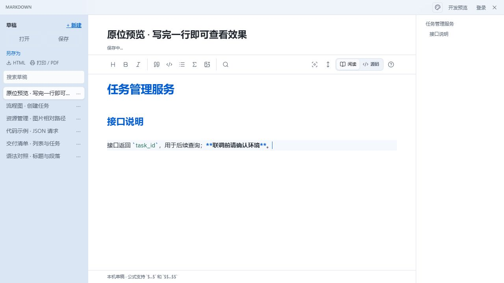
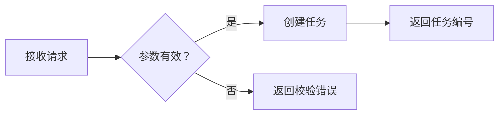

# Markdown 原位预览与项目文档编写

[返回产品介绍](../README.md) · [官网与下载](https://lingban.xyz/)

Muse Nexus 的 Markdown 工具可以在同一文档区域内编辑与呈现内容。下面用一份任务服务的接口说明演示操作，接口和字段仅为教学示例。

## 1. 编辑当前行

打开 Markdown 工具，保持工具栏“阅读”选中，输入：

```markdown
# 任务管理服务

## 接口说明

接口返回 `task_id`，用于后续查询；**联调前请确认环境**。
```

把光标停在最后一行，反引号与粗体星号可见，前面的标题呈现阅读效果。


## 2. 移开光标，查看原位预览

按回车进入下一行，或者将光标移动到其他行。上一行就在原位置显示行内代码和粗体效果。预览不以保存文件为前提，操作期间保持“阅读”选中即可。


## 3. 返回原行继续修改

用方向键或鼠标回到上一行，标记重新出现。可以修改字段名或强调范围，再移开光标检查效果。



文件仍然保存为 Markdown 文本。例如屏幕上显示粗体时，文件里保留的仍然是 `**文字**`。“源码”用于检查整篇标记，日常编辑与预览可以直接在“阅读”中完成。

## 4. 用标题、清单和表格组织 README

可以先写好章节，再补充内容：

```markdown
# 项目名称

简要说明项目解决什么问题。

## 快速开始

写明实际验证过的环境要求、配置方法与启动步骤。

## 接口说明

| 字段 | 类型 | 说明 |
| --- | --- | --- |
| title | string | 任务标题 |
| priority | integer | 优先级 |

## 交付检查

- [ ] 验证启动步骤
- [ ] 核对请求与响应示例
- [ ] 检查图片与链接
```

标题帮助建立层次并生成大纲，任务清单用于记录状态，表格用于对齐参数属性。表格和任务清单属于常见 Markdown 扩展，迁移到其他平台时应检查支持情况。

## 5. 多行内容按整个块预览

表格、围栏代码块、Mermaid 图和独立公式由多行共同构成。光标位于块内时编辑源码，离开整个块后检查完整效果。

例如请求体使用代码块：

````markdown
```json
{
  "title": "完善项目文档",
  "priority": 1
}
```
````

用 Mermaid 描述请求处理分支：

````markdown

````

公式可以用于技术笔记，例如平均延迟：

```markdown
$$
\bar{t}=\frac{1}{n}\sum_{i=1}^{n}t_i
$$
```

Mermaid 与数学公式需要目标平台提供相应渲染支持。编辑器里能显示，不代表所有发布平台和导出格式都会自动呈现相同效果。

## 6. 保存与交付

保存为项目目录中的 `README.md`，并把图片资源一起交付。需要网页文档时导出 HTML，需要 PDF 时使用“打印 / PDF”，最后在实际阅读环境中检查图片、代码块、表格、链接与分页。

本地图片引用不等于图片上传：`assets/screenshot.png` 指向项目内实际存在的文件，其他平台不能读取自己电脑上的绝对路径。HTML 分享也需要检查图片资源和路径。

截图来自浏览器开发预览。桌面文件操作请使用安装版。

延伸阅读：[完整 Markdown 教程](https://zhuanlan.zhihu.com/p/2092204243587446116)、[CommonMark](https://spec.commonmark.org/)、[GFM](https://github.github.com/gfm/)。
