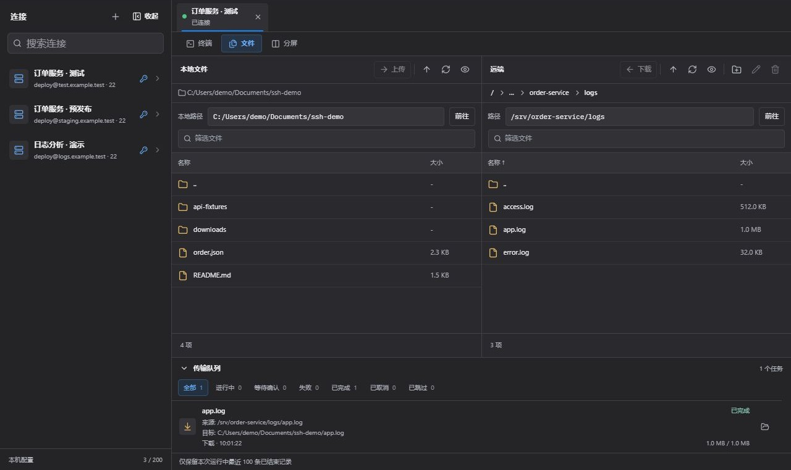

# SSH / SFTP：远程日志排查与文件传输

[返回产品介绍](../README.md) · [官网与下载](https://lingban.xyz/)

SSH / SFTP 已上线，在同一个工具中提供交互终端、本地与远端文件浏览，以及传输队列。下面以测试服务的日志排查为例，说明如何组合这些能力。截图采用演示主机与日志数据。

## 1. 创建连接并确认主机身份

在工具中心打开 SSH / SFTP，填写自己有权访问的主机、端口与用户名，选择密码或私钥认证。支持 Ed25519、RSA 以及加密私钥。

首次连接会在认证前显示主机指纹，核对后再选择本次信任或保存信任。已保存的主机密钥变化时，连接会被阻止，应先查明变化原因。

连接资料保存在本机；已保存的密码和私钥口令使用系统凭据管理器。“仅本次使用”适合只在本次连接中使用输入的凭据。

## 2. 终端与远端目录一起排查日志

连接成功后可进入终端，也可以切换到终端 / 远端分屏：左侧执行命令，右侧浏览日志目录。


假设日志位于 `/srv/order-service/logs/app.log`，可以在终端中执行：

```bash
tail -n 80 /srv/order-service/logs/app.log
```

路径为教学示例，使用时应替换为自己服务的实际日志位置。若需要在本地查看或分析完整日志，在文件视图中选择对应文件并下载。

## 3. 使用双栏文件视图传输

切到“文件”视图，左侧进入本地目标目录，右侧进入远端日志目录。选中远端文件后点击“下载”，文件传到左侧当前目录；上传时从左侧选择文件或文件夹，发送到右侧当前目录。



支持混合多选文件与文件夹；文件夹传输会保留目录结构、隐藏文件与空目录。传输队列可查看方向、来源、目标、字节进度和失败原因。

遇到同名文件时，界面明确询问覆盖、跳过或稍后处理。覆盖前请核对来源和目标路径。取消任务不会回滚已完成的文件；失败重试会重新创建任务并从头传输。

## 4. 多连接与视图切换

可保存和搜索连接配置，在不同标签中打开会话。终端、文件与分屏视图可以按任务切换：切回终端后后台传输继续，回到文件视图再查看队列；断开连接会取消该会话未完成的传输任务。

## 5. 当前支持范围

- 主要兼容目标为 Linux / Unix OpenSSH 服务端。
- 当前不提供跳板机、SSH agent、端口转发、远程编辑或断点续传。
- SSH 直接连接目标主机，Muse Nexus 账号服务不转发 SSH 流量。
- 远端主机需要提供 SFTP 子系统；覆盖上传需要相应的原子 SFTP 扩展支持。
- 终端输出和传输记录不作为长期历史保存，重要排查结论应另行记录。

截图为演示界面；真实服务器连接与文件传输需要使用桌面安装版。
